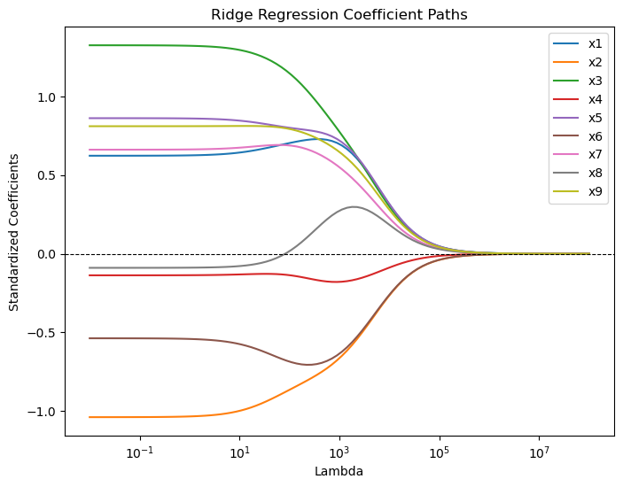

# Cleaning Messy Data + Ridge Regression

A 1,300-row regression dataset (`y` and predictors `x1`–`x9`) with real-world problems baked in. I cleaned it step by step, then used **ridge regression** to show how the penalty λ shrinks each coefficient, and checked that ridge at λ = 0 matches ordinary linear regression.

*Final project for an intermediate data science class at UC Davis.*



## Data cleaning: four problems found and fixed
| Problem | Evidence | Fix |
|---|---|---|
| Duplicate rows | 53 exact duplicates | Dropped (1,300 → 1,247 rows) |
| Inconsistent types | Six columns stored numbers as text | Converted everything to numeric |
| Missing values | Up to 71 missing per column | Filled with the column median |
| Outliers | Values outside 1.5 × IQR | Removed 90 rows → 1,157 clean rows |

## Modeling
- Standardized all predictors so the penalty treats them equally.
- Fit ridge across λ from 10⁻² to 10⁸ and plotted every coefficient's path to zero.
- Confirmed ridge at λ = 0 gives the same coefficients as OLS (x6 = −0.537 in both).
- The notebook ends with short write-ups on how ridge relates to linear regression, what λ controls, and why standardized coefficients matter.

## Run it
```bash
pip install -r requirements.txt
jupyter notebook ridge_regression_data_cleaning.ipynb
```

## Tools
Python · pandas · NumPy · scikit-learn · matplotlib
